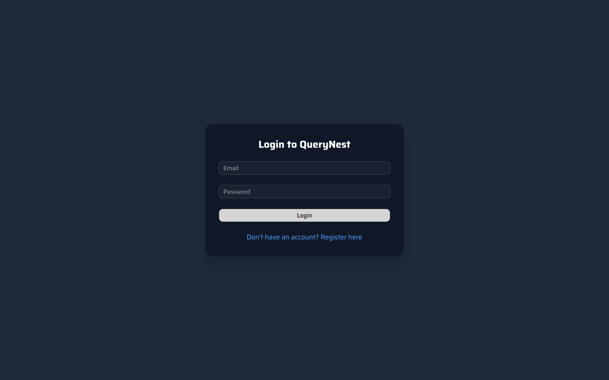
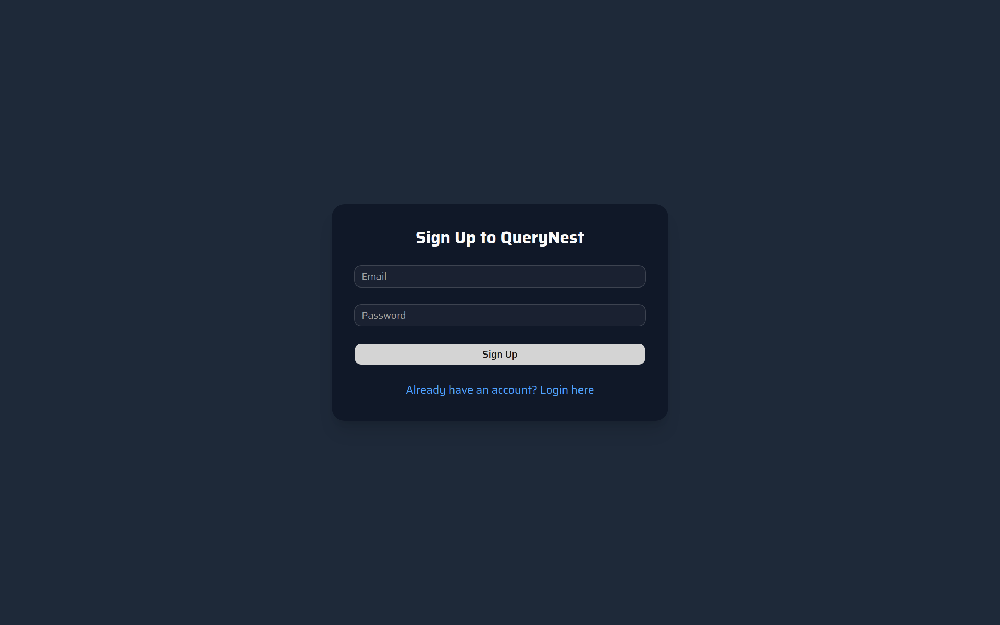
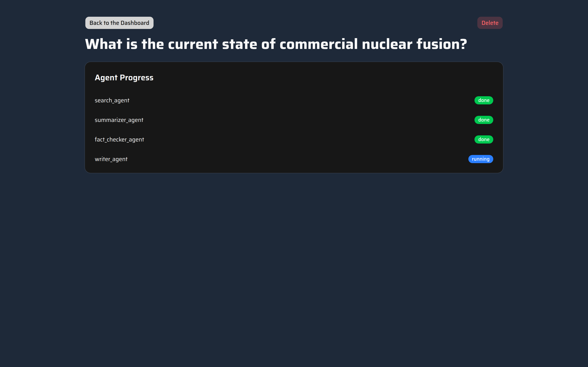
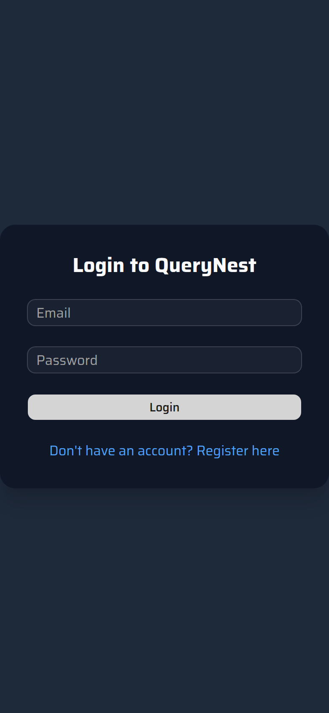
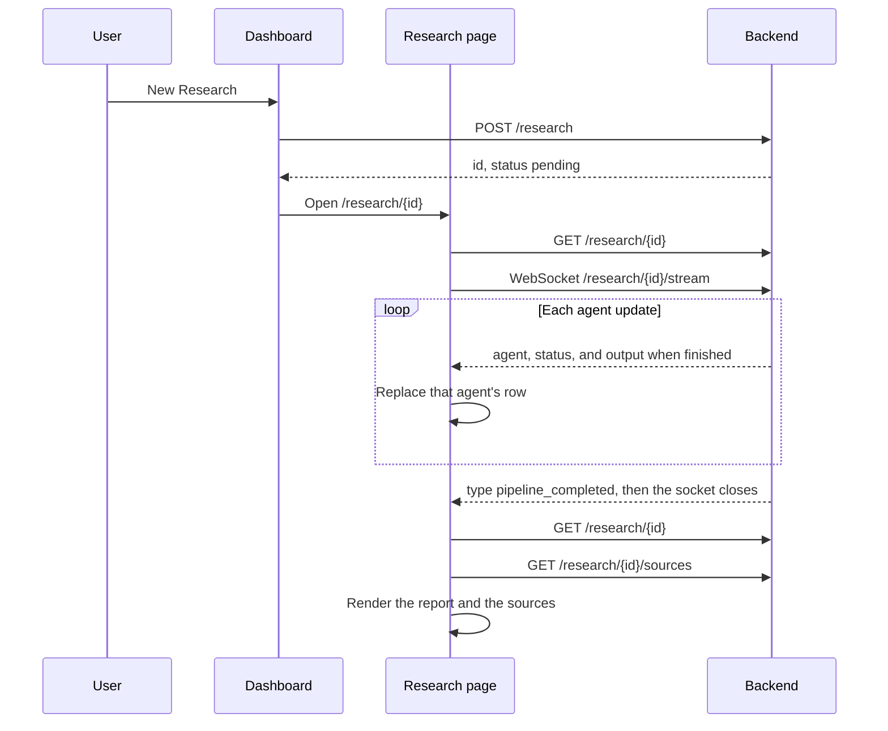

<div align="center">

# QueryNest — Frontend

### A multi-agent research assistant. Ask a question, watch the crew work, and read a sourced report.

<p>
  
  
  
  
  
  
  
</p>

<sub>Frontend repository · <a href="https://github.com/raosam23/query-nest-backend">Backend repository →</a> · <a href="https://github.com/raosam23/query-nest-infra">Infra repository →</a></sub>

</div>

---

## Screenshots

Real screens from this frontend, at a 1440×900 desktop viewport (login is also shown at a 390×844 phone width). The fusion brief is sample copy: REST responses and the research WebSocket are intercepted in the browser, so the images can be regenerated without the backend. See [Refreshing the screenshots](#refreshing-the-screenshots).

<table>
  <tr>
    <td width="50%" align="center" valign="top">
      
      <br />
      <sub>Sign in</sub>
    </td>
    <td width="50%" align="center" valign="top">
      
      <br />
      <sub>Create an account</sub>
    </td>
  </tr>
</table>

**History** — past sessions, and a new question ready to run.


**Agents** — search, summarize, and fact-check are done. The writer is still running.



**Report** — the finished session: the crew summary, the markdown brief, and the sources with credibility scores.


**Phone** — the login card at a 390px-wide viewport.

<p align="center">
  
</p>

---

## Table of Contents

- [Screenshots](#screenshots)
- [What is QueryNest?](#what-is-querynest)
- [Features](#features)
- [How live updates work](#how-live-updates-work)
- [Tech stack](#tech-stack)
- [Project structure](#project-structure)
- [Getting started](#getting-started)
- [Environment](#environment)
- [Scripts](#scripts)
- [Refreshing the screenshots](#refreshing-the-screenshots)

---

## What is QueryNest?

QueryNest is a research assistant. You ask one question, and a LangGraph crew searches the web, pulls out the claims, fact-checks them, and writes a markdown report. Each source gets an LLM credibility score.

This is the **frontend repository**. It talks to the [QueryNest backend](https://github.com/raosam23/query-nest-backend), which runs the crew (search, summarizer, fact checker, writer), stores sessions in Postgres, and streams agent status over a WebSocket. Running the pair with Docker Compose lives in [query-nest-infra](https://github.com/raosam23/query-nest-infra).

While the socket is open, the page shows one row per agent. When the socket closes, the report and the sources render under those rows. Opening a session that is already finished skips the socket and shows a one-line crew summary instead of the rows.

---

## Features

- **Accounts** — register and sign in with email and password. The access token is stored in a `token` cookie (7 days, not httpOnly) and sent as `Authorization: Bearer`. Logout clears that cookie in the browser. There is no logout request.
- **Route guard** — `src/proxy.ts` sends `/` to `/dashboard` or `/login`, keeps a signed-in user out of the auth pages, and sends an anonymous user away from `/dashboard` and `/research`.
- **History** — the dashboard lists your sessions, newest first, with a `pending`, `running`, `done`, or `failed` badge.
- **New research** — a question goes to `POST /research`. The API returns the session immediately, and the app opens `/research/{id}`.
- **Live agent rows** — while the session is `pending` or `running`, the page opens `ws://localhost:8000/research/{id}/stream` and shows each agent's name and status.
- **Report** — when the status is `done`, `final_report` is rendered as markdown under the agent card.
- **Finished sessions** — opening one that is already `done` skips the socket. The progress card is the line "4 agents completed • Search → Summarize → Fact Check → Write".
- **Sources** — title, URL, snippet, and credibility. The score is a 0–1 float, shown as a percent.
- **Delete** — from the dashboard or the research page. The API returns `{ status: 200, msg }`.
- **Toasts** — Sonner, for sign-in, sign-up, logout, and delete.
- **Dark theme** — `html` is `dark`, pages use `bg-gray-800`, and the typeface is Saira.

---

## How live updates work

JSON calls go through Axios. The research page opens the WebSocket itself. A new session comes back from `POST /research` as `pending`. The background crew then marks it `running`, and this page treats those two statuses the same: it connects.



Messages look like this:

```json
{ "agent": "search_agent", "status": "running" }
{ "agent": "search_agent", "status": "done", "output": "Found 5 results" }
{ "type": "pipeline_completed" }
```

The crew emits those for `search_agent`, `summarizer_agent`, `fact_checker_agent`, and `writer_agent`, in that order. The supervisor that routes them is not a row. This client shows the agent name and the status badge. It keeps `output` on the update and does not render it. A message with no `agent` (including `pipeline_completed`) is ignored. The server then closes the socket, `onclose` refetches the session and the sources, and a `done` session renders the report.

Opening a session that is already `done` skips the socket. The progress card then reads "4 agents completed • Search → Summarize → Fact Check → Write". A `failed` session with no rows reads "Research pipeline failed".

---

## Tech stack

| Layer | Choice |
| ----- | ------ |
| Framework | Next.js 16 (App Router, React 19) |
| Language | TypeScript 5 |
| Styling | Tailwind CSS v4 |
| UI components | shadcn/ui (`radix-nova`) on Radix |
| HTTP | Axios |
| Markdown | react-markdown, styled with `@tailwindcss/typography` |
| Notifications | Sonner (`next-themes` reads the theme for the toaster) |
| Icons | lucide-react |
| Font | Saira (`next/font`) |
| Package manager | npm |

---

## Project structure

```
src/
├── app/
│   ├── (auth)/
│   │   ├── login/page.tsx
│   │   └── register/page.tsx
│   ├── research/[id]/page.tsx    # Agent rows, report, sources
│   ├── dashboard/page.tsx        # History and the new-query box
│   ├── utils/SessionStyles.ts    # Status badge colors
│   ├── globals.css
│   ├── layout.tsx
│   └── page.tsx                  # Empty. The proxy redirects /
├── components/
│   ├── auth/AuthForm.tsx
│   └── ui/                       # shadcn components
├── lib/
│   ├── api.ts                    # Axios client, Bearer header
│   ├── auth.ts                   # Login, register, cookie
│   └── utils.ts
├── proxy.ts                      # Route guard
└── types/index.ts
```

| Path | Auth | What it does |
| ---- | ---- | ------------ |
| `/` | — | Redirects to `/dashboard` when a `token` cookie is present, otherwise `/login`. |
| `/login` | Public | Email and password, then the dashboard. |
| `/register` | Public | Email and password. Register signs you in. |
| `/dashboard` | Guarded | Session history, new research, delete. |
| `/research/[id]` | Guarded | Live agent rows, then the report and sources. |

### Backend routes this UI calls

| Action | Method and path |
| ------ | --------------- |
| Register | `POST /auth/register` |
| Login | `POST /auth/login` |
| List sessions | `GET /history` |
| Delete a session | `DELETE /history/{session_id}` |
| Start research | `POST /research` |
| One session | `GET /research/{session_id}` |
| Sources | `GET /research/{session_id}/sources` |
| Live agent status | `WS /research/{session_id}/stream` |

`POST /auth/register` returns `{ message, email }`. `POST /auth/login` returns `{ access_token, token_type }`. A session is `{ id, query, status, final_report, created_at }`. A source is `{ id, url, title, snippet, credibility_score }`. Delete returns `{ status, msg }`.

---

## Getting started

QueryNest needs both repositories. This frontend calls `http://localhost:8000` and opens its WebSocket on the same host. Start the [backend](https://github.com/raosam23/query-nest-backend) first. A live query also needs that service's database, `JWT_SECRET`, OpenAI key, and Tavily key. The screenshots in this README do not.

To run the frontend, the API, and Postgres together, use [query-nest-infra](https://github.com/raosam23/query-nest-infra) (`docker compose up --build`). The `Dockerfile` in this repo runs `npm run dev`.

### Prerequisites

- Node.js 20 or newer
- npm
- The QueryNest backend on port 8000, if you want live research rather than the screenshot mock

### Clone and install

```bash
git clone https://github.com/raosam23/query-nest-frontend
cd query-nest-frontend
npm install
```

### Run

```bash
npm run dev
```

Open [http://localhost:3000](http://localhost:3000). Register, ask a question, and stay on the research page while the four agents report in. When the socket closes, the report and the sources replace the wait.

---

## Environment

This app does not read an env file. Nothing is prefixed with `NEXT_PUBLIC_`. The origin is hardcoded:

| Location | Value |
| -------- | ----- |
| `src/lib/api.ts` | Axios `baseURL` is `http://localhost:8000` |
| `src/app/research/[id]/page.tsx` | WebSocket is `ws://localhost:8000/research/{id}/stream` |

The token cookie is written by the browser. Axios copies it into the `Authorization` header. It is not sent as a cookie to the API.

---

## Scripts

| Command | Description |
| ------- | ----------- |
| `npm run dev` | Start the development server |
| `npm run build` | Production build |
| `npm run start` | Serve the production build |
| `npm run lint` | Run ESLint |
| `npm run screenshots` | Rebuild the app and refresh `docs/screenshots/` |

---

## Refreshing the screenshots

[`scripts/capture-screenshots.mjs`](scripts/capture-screenshots.mjs) rebuilds the production app, opens it in headless Chrome, and saves PNGs to `docs/screenshots/`.

Requests to `http://localhost:8000` and the research WebSocket are intercepted in the browser. The mock covers every call this UI makes: register, login, session list, create, fetch, sources, and delete, plus the agent stream (`running`, then `done` with `output`, then `pipeline_completed`, then the socket closes). Nothing in the application code is stubbed. No Postgres, LLM key, or running backend is required.

Google Chrome needs to be installed, and port 3000 needs to be free.

```bash
npm run screenshots
```

---

Ask a question. Four agents search, check the claims, and write the report.
